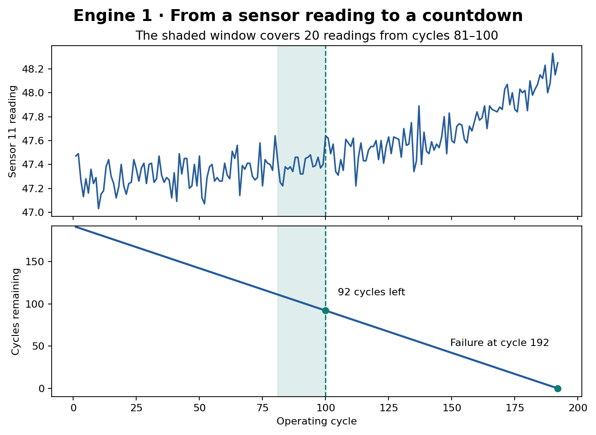
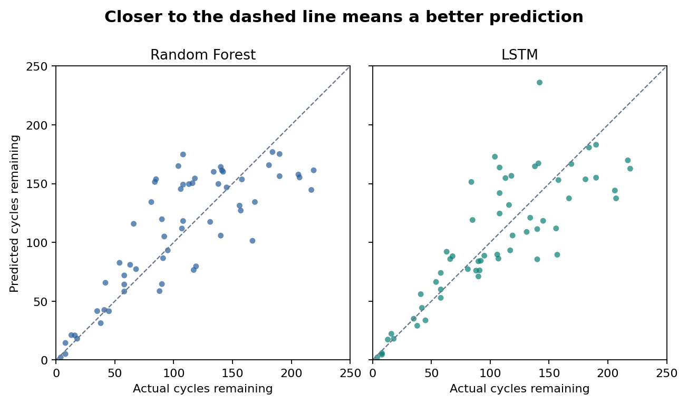

# Predict‑X · How many cycles does an engine have left?

Predict‑X learns from simulated aircraft engines. We give the computer a record of what an engine has done so far and ask it to predict **how many more operating cycles the engine can complete before it fails**. We call that number **remaining useful life**, or **RUL**.

Think of an engine log as a notebook. Every operating cycle adds a new row of readings. During training, the computer can check its guesses against the answers from engines that ran until failure. At prediction time, it gets the pages written so far.

## 1. Open an engine log

We use **FD001**, a part of NASA’s C‑MAPSS turbofan simulation dataset. Each measurement row describes one engine at one point in time.

| What’s in the row | What it means |
| --- | --- |
| Engine ID | Which engine made the reading |
| Cycle number | How many operating cycles that engine has completed |
| Three operating settings | How the engine was being operated |
| 21 sensor readings | Measurements that tell us about the engine’s condition |

`train_FD001.txt` has full logs for **100 engines** that ran until failure. `test_FD001.txt` has partial logs for **100 other engines**. The separate file `RUL_FD001.txt` gives the answer for the final recorded cycle of each official test engine. [NASA dataset](https://data.nasa.gov/dataset/cmapss-jet-engine-simulated-data)

## 2. Turn each known failure into a countdown

In a complete log, the last recorded cycle is the failure cycle. Subtract the current cycle from it to get the answer for that row.

```text
Remaining useful life = failure cycle − current cycle
Engine 1 at cycle 100  = 192 − 100 = 92 cycles left
```



The top panel shows one of the readings the models can use. The bottom panel shows the answer we want the models to learn. At cycle 100, the answer is **92**. One cycle later, the answer is **91**.

## 3. Give the models a fair practice quiz

We split the 100 complete logs into **80 training engines** and **20 validation engines** using a fixed seed of 42, so the same engines land in each group every time we rerun it. One engine’s rows all go into the same group. If we put some pages of one engine’s log into practice and other pages into the quiz, the model could recognize that engine and make the quiz look easier than it is. That shortcut is called **data leakage**.

For the quiz, every model guesses at cycles **50, 100, and 150** where those cycles exist. One validation engine stopped before cycle 150, so there are **59 guesses** in total. These practice scores come from the complete logs. The official test set is a separate set of engines with shorter, unfinished logs.

## 4. Start with simple guesses, then train a Random Forest

We try three ways to answer the same question with one row at a time.

1. **Training median.** Sort all the training answers and always guess the middle value.
2. **Random Forest with age only.** Give the model the current cycle number. Engines of the same age get the same prediction from this model.
3. **Random Forest with age and readings.** Also give it the three operating settings and the 21 sensor values recorded at that cycle.

A Random Forest grows **100 decision trees** in our setup. A tree learns simple questions from the practice data, such as “Is this sensor reading above a certain value?” Following the answers through one tree leads to its guess. The forest averages all 100 guesses. Both forests use the same training settings, so the comparison shows what changes when we give the forest the extra measurements. [Random Forest code](src/baseline.py)

## 5. Let the LSTM read 20 rows in order

A single row tells us what the engine looks like now. A **window** lets the model see how those readings have been changing.

```text
Read cycles 81 through 100 → predict the RUL at 100 → answer is 92
Read cycles 82 through 101 → predict the RUL at 101 → answer is 91
```

Each input window contains **20 rows**, each with **25 numbers** (cycle, three settings, and 21 sensors). A window stays within one engine and stops at the cycle where we make the guess. We built **15,041 training windows** this way. [Window-building code](src/windows.py)

An **LSTM** is a model that reads rows in order and updates an internal summary after each one. A final layer turns the summary after row 20 into one prediction. Before training, we put the input columns on comparable scales using statistics from the 80 training engines. We apply those same statistics to the validation inputs. [LSTM code](src/lstm.py)

## 6. Watch the LSTM learn from its mistakes

One pass through the training windows is an **epoch**. The LSTM makes guesses, measures how far they are from the answers, and updates itself in small batches. We trained for **15 epochs**, using up to **128 windows** per batch. Each batch gives the model one chance to adjust its weights.


The line shows error on the training windows while the model was updating. The next chart shows how it did on the held-out engines after training ended.

## 7. Compare the models on the same quiz

If the correct answer is **80** and the model guesses **65**, the absolute error is **15 cycles**. **Mean absolute error (MAE)** averages those misses. **Root mean squared error (RMSE)** gives bigger mistakes more weight. For both numbers, lower is better.


| Model | Average error (MAE) | Error with extra weight on big misses (RMSE) |
| --- | ---: | ---: |
| Training median | 46.31 cycles | 56.69 cycles |
| Random Forest, age only | 36.99 cycles | 41.04 cycles |
| Random Forest, age and readings | 25.54 cycles | 32.88 cycles |
| LSTM, last 20 cycles of readings | **24.14 cycles** | **32.48 cycles** |



Each dot is one guess. A dot on the dashed line means the guess was exactly right. A dot above it means the model guessed too many cycles. A dot below it means it guessed too few. The LSTM’s average miss was **1.40 cycles smaller** than the full Random Forest’s on this split. That comparison uses one validation split and fixed prediction cycles.

## 8. Take the final quiz on NASA’s official test engines

We kept the model settings from the practice quiz and fitted the models again using **all 100 complete training histories**. Then we made **one prediction for each of the 100 official test engines**, at the last cycle in its provided log. The Random Forest read the last row. The LSTM read the last 20 rows. Both models answered for the same engine at the same point in time.

For example, the first official test engine’s log ends at **cycle 31**. In the simulation, it had **112 cycles left** at that point. We get that answer from the separate answer file after making the predictions. For the LSTM, the input is cycles **12 through 31** from the partial log.

| Model | Official test MAE | Official test RMSE |
| --- | ---: | ---: |
| Training median | 39.08 cycles | 49.82 cycles |
| Random Forest, age only | 31.43 cycles | 36.75 cycles |
| Random Forest, age and readings | 19.93 cycles | **26.69 cycles** |
| LSTM, last 20 cycles of readings | **19.53 cycles** | 28.69 cycles |

The LSTM missed by about **19.53 cycles on average**, 0.40 cycles less than the full Random Forest. The Random Forest scored better when the metric gave larger mistakes more weight. These scores summarize the 100 official FD001 test predictions after refitting on all complete logs. The validation scores above use a different training split and different prediction cycles.

[Official evaluation code](src/evaluate.py)

## 9. Save a model and use it for a new prediction

Training and predicting are two separate jobs. **Training** builds the trees from complete engine histories. It runs once and saves the fitted Random Forest and its input column order. **Inference** is what happens later when you hand the saved forest a new reading and ask for a guess.

```sh
python -m src.train_model
python -m src.predict data/raw/test_FD001.txt --engine 1
```

1. The first command trains on the **100 complete FD001 histories** and writes `models/random_forest_fd001.joblib`. The file includes the fitted trees, the dataset name, the scikit-learn version, and the order of the 25 input columns.
2. The second command loads that file, finds engine 1’s latest row, and prints how many cycles it estimates are left. At cycle 31, our saved model estimated **171.73 cycles left** for engine 1. NASA’s answer was **112 cycles**, so this particular prediction was about 60 cycles high. You can run the prediction command again in a new terminal with the project environment active.
3. The prediction command only needs the saved model and the engine log. NASA’s answer file is used by the separate evaluation command when we want to score predictions.

We chose the Random Forest for this first inference workflow because it had the lower official-test RMSE and can work with a single observation. The model file is generated locally using the training command. [Training code](src/train_model.py) · [Prediction code](src/predict.py)

## 10. Ask the saved model for a prediction over HTTP

FastAPI gives the dashboard a way to talk to Predict‑X. Think of the **request** as a question containing the engine’s latest measurements. The **response** is the model’s estimate of how many cycles are left. The server loads the saved forest once when it starts and uses it for each request.

1. Install the project dependencies with `python -m pip install -r requirements.txt`. If you haven’t trained and saved the forest yet, run `python -m src.train_model`.
2. Start the server from the project folder.

   ```sh
   python -m uvicorn src.api:app
   ```

3. Open [the local API playground](http://127.0.0.1:8000/docs). Expand **POST /predict**, click **Try it out**, paste this reading from engine 1 at cycle 31, and click **Execute**.

   ```json
   {
     "cycle": 31,
     "settings": [-0.0006, 0.0004, 100.0],
     "sensors": [
       518.67, 642.58, 1581.22, 1398.91, 14.62, 21.61, 554.42,
       2388.08, 9056.4, 1.3, 47.23, 521.79, 2388.06, 8130.11,
       8.4024, 0.03, 393.0, 2388.0, 100.0, 38.81, 23.3552
     ]
   }
   ```

   The response includes `cycle`, the model ID `random_forest_fd001`, and `predicted_rul_cycles` (about **171.73** for this example). Supply settings 1–3 and sensors 1–21 in their original order. If the request is missing a measurement, the API returns status **422** and identifies the field to fix.

| Endpoint | What it does |
| --- | --- |
| `GET /health` | Confirms the server started and loaded the saved forest. |
| `GET /models` | Lists the available model, its dataset, and input columns. |
| `POST /predict` | Estimates the cycles remaining from one reading. |
| `POST /predict/batch` | Takes a JSON object with a `readings` list and returns one estimate per reading, in the same order. |

[FastAPI code](src/api.py) · [API tests](tests/test_api.py)

## 11. Explore an engine in the React dashboard

The dashboard connects the model to a screen you can interact with. It loads partial histories from the 100 simulated FD001 test engines, then sends one selected row to the prediction API.

1. Install the Python dependencies, put the FD001 files in `data/raw/`, and run `python -m src.train_model` if you haven’t saved the forest yet.
2. Start the API in one terminal at the repository root.

   ```sh
   python -m uvicorn src.api:app
   ```

3. In a second terminal at the repository root, use Node.js 22.12 or newer to install and start the dashboard.

   ```sh
   npm --prefix dashboard ci
   npm --prefix dashboard run dev
   ```

4. Open the local URL printed by Vite (usually `http://localhost:5173`). Pick an engine, move the **Prediction cycle** slider, and choose a sensor. The chart shows readings through the selected cycle.
5. Click **Predict remaining life**. For engine 1 at its last recorded cycle (31), the model estimates **171.73 cycles**. Moving the slider changes which reading the model receives. Switching the chart’s sensor changes what you see while the prediction still uses all 21 sensors.

The dashboard reads the engine list from `GET /engines` and the selected history from `GET /engines/{engine_id}`. It sends the selected cycle and its readings to `POST /predict`. The Vite proxy forwards those requests to FastAPI on port 8000. To use another API address, set `PREDICTX_API_TARGET` before running Vite. Build the frontend with `npm --prefix dashboard run build`. [React dashboard code](dashboard/src/main.jsx) · [FastAPI routes](src/api.py)

## 12. Build the hosted FD001 demo

The hosted demo lets you explore every recorded cycle from all **100 FD001 test engines**. It displays estimates exported from the saved Random Forest for those **13,096 readings**. This lets an HTML host serve the dashboard as files. For live inference on new readings, run FastAPI and the dashboard as described above.

Once you have trained and saved the forest, export the readings and estimates, then build the dashboard in hosted mode:

```sh
python -m src.export_demo
VITE_PREDICTX_HOSTED_DEMO=1 npm --prefix dashboard run build
```

On Windows PowerShell, set `$env:VITE_PREDICTX_HOSTED_DEMO = "1"` before running the build command. The output is in `dashboard/dist/`. The exporter reads `test_FD001.txt` for the sensor readings. NASA’s answer file is used by the separate official test command. [Demo exporter](src/export_demo.py)

## Run it yourself

1. Clone the repository and create a Python environment (Python 3.10 or newer).

   ```sh
   git clone https://github.com/jattu8602/Predict-X.git
   cd Predict-X
   python -m venv .venv
   ```

2. Activate the environment with `source .venv/bin/activate` on macOS or Linux, or `.\.venv\Scripts\Activate.ps1` in Windows PowerShell. Then install the project dependencies.

   ```sh
   python -m pip install -r requirements.txt
   ```

   To train the LSTM, run the official test, or regenerate the README figures, also install the CPU build of PyTorch for your system. [PyTorch installation instructions](https://pytorch.org/get-started/locally/)

3. Extract these three files from the NASA download into `data/raw/`. The project archive may already contain them.

   ```text
   data/raw/train_FD001.txt
   data/raw/test_FD001.txt
   data/raw/RUL_FD001.txt
   ```

   [Download the NASA C‑MAPSS data](https://data.nasa.gov/dataset/cmapss-jet-engine-simulated-data)

4. Run the project from its root folder. Each command can be run on its own after setup.

   | Command | What you get |
   | --- | --- |
   | `python -m src.eda` | Sensor summaries and exploratory plots in `outputs/figures/`. |
   | `python -m src.preprocessing` | Labeled and scaled data, separate test answers, and a fitted scaler in `data/processed/`. |
   | `python -m src.baseline` | Validation results for the three single-row models. |
   | `python -m src.windows` | Window sizes and a labeled example. |
   | `python -m src.lstm` | Training error at each epoch and the final validation scores. |
   | `python -m src.evaluate` | Scores at the last recorded cycle of each official test engine. |
   | `python -m src.visualize` | Retrains the models and regenerates the four pictures in `docs/figures/`. |
   | `python -m src.train_model` | Saves the trained Random Forest to `models/`. |
   | `python -m src.predict data/raw/test_FD001.txt --engine 1` | Loads the saved forest and predicts from engine 1’s last reading. |
   | `python -m uvicorn src.api:app` | Serves the saved forest and opens the API playground at `/docs`. |
   | `python -m pytest -q` | Checks data preparation, windows, model reload, and the API. |

Open [the exploration notebook](notebooks/01_eda.ipynb) to see more sensor summaries, correlations, and engine plots. To run it from the project root, start Jupyter with `jupyter notebook`.
