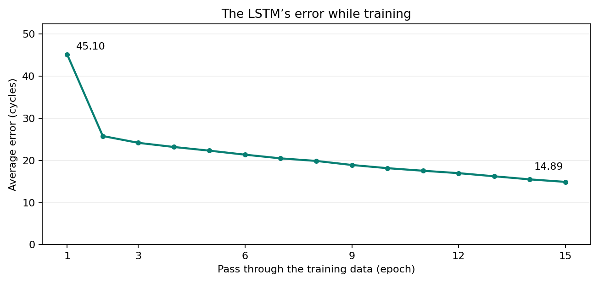
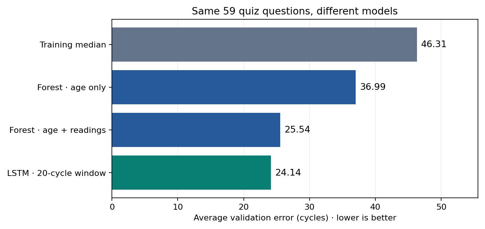

# Predict‑X · How many cycles does an engine have left?

Predict‑X learns from simulated aircraft engines. We give the computer a record of what an engine has done so far and ask it to predict **how many more operating cycles the engine can complete before it fails**. We call that number **remaining useful life**, or **RUL**.

Think of an engine log as a notebook. Every operating cycle adds a new row of readings. During training, the computer can check its guesses against the answers from engines that ran until failure. At prediction time, it gets the pages written so far.

## 1. Open an engine log

We use **FD001**, a part of NASA’s C‑MAPSS turbofan simulation dataset. Each measurement row describes one engine at one point in time.

| What’s in the row | What it means |
| --- | --- |
| Engine ID | Which engine made the reading |
| Cycle number | How many operating cycles that engine has completed |
| Three operating settings | How the engine was being operated |
| 21 sensor readings | Measurements that tell us about the engine’s condition |

`train_FD001.txt` has full logs for **100 engines** that ran until failure. `test_FD001.txt` has partial logs for **100 other engines**. The separate file `RUL_FD001.txt` gives the answer for the final recorded cycle of each official test engine. [NASA dataset](https://data.nasa.gov/dataset/cmapss-jet-engine-simulated-data)

## 2. Turn each known failure into a countdown

In a complete log, the last recorded cycle is the failure cycle. Subtract the current cycle from it to get the answer for that row.

```text
Remaining useful life = failure cycle − current cycle
Engine 1 at cycle 100  = 192 − 100 = 92 cycles left
```


The top panel shows one of the readings the models can use. The bottom panel shows the answer we want the models to learn. At cycle 100, the answer is **92**. One cycle later, the answer is **91**.

## 3. Give the models a fair practice quiz

We split the 100 complete logs into **80 training engines** and **20 validation engines** using a fixed seed of 42, so the same engines land in each group every time we rerun it. One engine’s rows all go into the same group. If we put some pages of one engine’s log into practice and other pages into the quiz, the model could recognize that engine and make the quiz look easier than it is. That shortcut is called **data leakage**.

For the quiz, every model guesses at cycles **50, 100, and 150** where those cycles exist. One validation engine stopped before cycle 150, so there are **59 guesses** in total. The separate official test set is reserved for final evaluation. The scores below come from this practice quiz.

## 4. Start with simple guesses, then train a Random Forest

We try three ways to answer the same question with one row at a time.

1. **Training median.** Sort all the training answers and always guess the middle value.
2. **Random Forest with age only.** Give the model the current cycle number. Engines of the same age get the same prediction from this model.
3. **Random Forest with age and readings.** Also give it the three operating settings and the 21 sensor values recorded at that cycle.

A Random Forest grows **100 decision trees** in our setup. A tree learns simple questions from the practice data, such as “Is this sensor reading above a certain value?” Following the answers through one tree leads to its guess. The forest averages all 100 guesses. Both forests use the same training settings, so the comparison shows what changes when we give the forest the extra measurements. [Random Forest code](src/baseline.py)

## 5. Let the LSTM read 20 rows in order

A single row tells us what the engine looks like now. A **window** lets the model see how those readings have been changing.

```text
Read cycles 81 through 100 → predict the RUL at 100 → answer is 92
Read cycles 82 through 101 → predict the RUL at 101 → answer is 91
```

Each input window contains **20 rows**, each with **25 numbers** (cycle, three settings, and 21 sensors). A window stays within one engine and stops at the cycle where we make the guess. We built **15,041 training windows** this way. [Window-building code](src/windows.py)

An **LSTM** is a model that reads rows in order and updates an internal summary after each one. A final layer turns the summary after row 20 into one prediction. Before training, we put the input columns on comparable scales using statistics from the 80 training engines. We apply those same statistics to the validation inputs. [LSTM code](src/lstm.py)

## 6. Watch the LSTM learn from its mistakes

One pass through the training windows is an **epoch**. The LSTM makes guesses, measures how far they are from the answers, and updates itself in small batches. We trained for **15 epochs**, using up to **128 windows** per batch. Each batch gives the model one chance to adjust its weights.



The line shows error on the training windows while the model was updating. The next chart shows how it did on the held-out engines after training ended.

## 7. Compare the models on the same quiz

If the correct answer is **80** and the model guesses **65**, the absolute error is **15 cycles**. **Mean absolute error (MAE)** averages those misses. **Root mean squared error (RMSE)** gives bigger mistakes more weight. For both numbers, lower is better.



| Model | Average error (MAE) | Error with extra weight on big misses (RMSE) |
| --- | ---: | ---: |
| Training median | 46.31 cycles | 56.69 cycles |
| Random Forest, age only | 36.99 cycles | 41.04 cycles |
| Random Forest, age and readings | 25.54 cycles | 32.88 cycles |
| LSTM, last 20 cycles of readings | **24.14 cycles** | **32.48 cycles** |


Each dot is one guess. A dot on the dashed line means the guess was exactly right. A dot above it means the model guessed too many cycles. A dot below it means it guessed too few. The LSTM’s average miss was **1.40 cycles smaller** than the full Random Forest’s on this split. We have one validation split so far, and final performance on the official test set is still unknown.

## Run it yourself

1. Clone the repository and create a Python environment (Python 3.10 or newer).

   ```sh
   git clone https://github.com/jattu8602/Predict-X.git
   cd Predict-X
   python -m venv .venv
   ```

2. Activate the environment with `source .venv/bin/activate` on macOS or Linux, or `.\.venv\Scripts\Activate.ps1` in Windows PowerShell. Then install the project dependencies.

   ```sh
   python -m pip install -r requirements.txt
   ```

   To train the LSTM or regenerate the README figures, also install the CPU build of PyTorch for your system. [PyTorch installation instructions](https://pytorch.org/get-started/locally/)

3. Extract these three files from the NASA download into `data/raw/`. The project archive may already contain them.

   ```text
   data/raw/train_FD001.txt
   data/raw/test_FD001.txt
   data/raw/RUL_FD001.txt
   ```

   [Download the NASA C‑MAPSS data](https://data.nasa.gov/dataset/cmapss-jet-engine-simulated-data)

4. Run the project from its root folder. Each command can be run on its own after setup.

   | Command | What you get |
   | --- | --- |
   | `python -m src.eda` | Sensor summaries and exploratory plots in `outputs/figures/`. |
   | `python -m src.preprocessing` | Labeled and scaled data, separate test answers, and a fitted scaler in `data/processed/`. |
   | `python -m src.baseline` | Validation results for the three single-row models. |
   | `python -m src.windows` | Window sizes and a labeled example. |
   | `python -m src.lstm` | Training error at each epoch and the final validation scores. |
   | `python -m src.visualize` | Retrains the models and regenerates the four pictures in `docs/figures/`. |
   | `python -m pytest -q` | Checks RUL labels, the split, and the window logic. |

Open [the exploration notebook](notebooks/01_eda.ipynb) to see more sensor summaries, correlations, and engine plots. To run it from the project root, start Jupyter with `jupyter notebook`.
